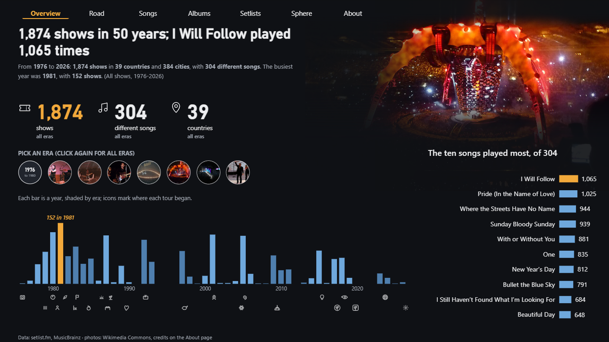
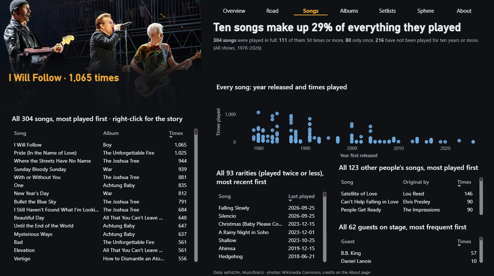
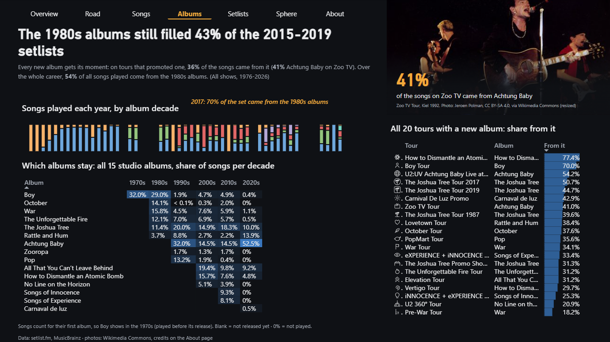
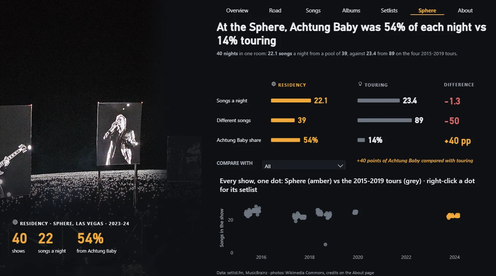
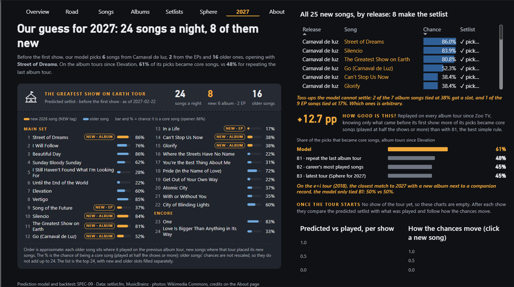
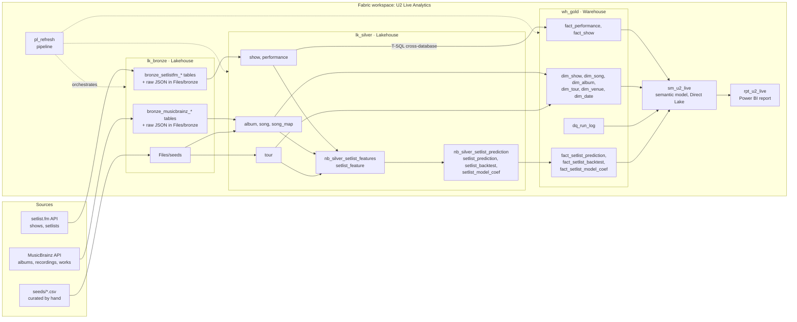
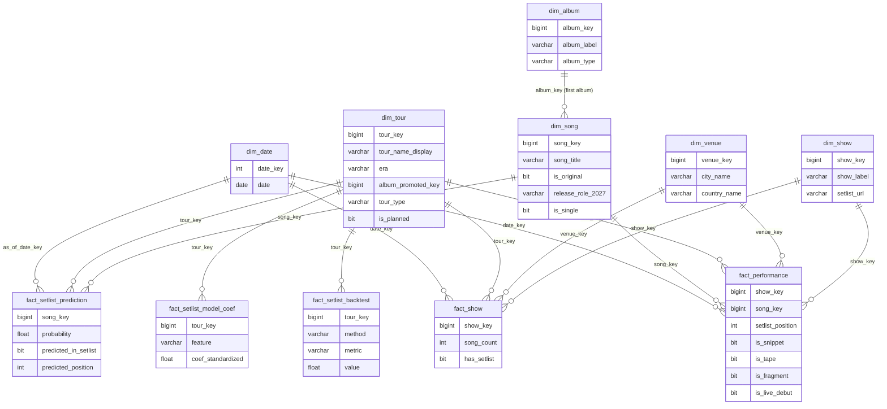

# U2 Live Analytics

**Fifty years of U2 on stage (1,874 shows, 29,366 songs played in full) turned into a Microsoft Fabric medallion
pipeline and a ten-page Power BI report, including a forecast of the 2027 setlist.**

Data from [setlist.fm](https://www.setlist.fm) and [MusicBrainz](https://musicbrainz.org) · Bronze and Silver
lakehouses (PySpark), a Gold warehouse (T-SQL), a Direct Lake semantic model and a PBIR report, all in Microsoft Fabric.
Built by Vinicius Baccarini ([LinkedIn](https://www.linkedin.com/in/vin%C3%ADcius-baccarini/)) with Claude Code.

> Repository: <https://github.com/vicocbc/u2-live-analytics> ·
> 

---

## Three findings and a forecast

Numbers from the Gold builds of 2026-10-22 (findings) and 2026-10-26 (forecast); each one was reproduced with T-SQL
on the warehouse and a DAX query on the model ([`docs/run-log.md`](docs/run-log.md), [`tests/dax/`](tests/dax/)).
"Performances" means songs played in full: snippets, tapes and lead-in fragments are left out.

**1. Ten songs make up 29% of everything U2 has played live.** Out of 304 different songs, the top ten account for
8,624 of 29,366 performances. *I Will Follow*, from the 1980 debut, leads with 1,065 performances at 1,004 of the
1,874 shows.

**2. The 1980s albums never left the setlist.** Songs from the six 1980s studio albums (Boy to Rattle and Hum) are 54%
of every song ever played live, and still 43% of the setlists on the 2015-2019 tours. On the 2017 Joshua Tree
anniversary tour they reached 70%.

**3. At the Sphere, one album carried the night.** Across 40 nights in Las Vegas (2023-24), Achtung Baby made up 54% of
each setlist, against 14% on the 2015-2019 tours. Nights were about as long (22.1 songs against 23.4) but drew on
39 different songs instead of 89.

**4. Forecast: 24 songs a night in 2027, 8 of them new.** A setlist model trained on past album tours expects 6 songs
from *Carnaval de luz* and 2 from the 2026 EPs, with *Street of Dreams* as the opener. Backtested on the album tours
since Elevation (2001), 61% of its picks became core songs of the tour (played at half the shows or more), against
48% for repeating the last album tour (B1) and 45% for the career's most played songs (B2) or the latest tour, which
for 2027 is the Sphere (B3). The caveat: on Experience + Innocence, the closest analog, the model only tied B1, and
the last new-song slots are decided by ties.

More pages: [on the road](docs/img/02-road.png) · [setlist evolution](docs/img/05-setlists.png) ·
[song detail](docs/img/07-song.png) · [show detail](docs/img/08-show.png) ·
[next tour (2027)](docs/img/10-next-tour.png) · [about the data](docs/img/09-about.png) ·
drill-through demos: [road → show](docs/img/drill-show.gif), [songs → song](docs/img/drill-song.gif).
The twelve business questions behind the pages (the optional Q11 is not built yet) are in
[`docs/charter.md`](docs/charter.md).

---

## Architecture

| Layer | Technology | In this repo |
| --- | --- | --- |
| Bronze, Silver | Fabric Lakehouses, PySpark notebooks, `u2lib` (pure Python, unit-tested) with `rapidfuzz` | [`fabric/nb_*.Notebook/`](fabric/), [`src/u2lib/`](src/u2lib/), [`tests/`](tests/) |
| Gold | Fabric Warehouse, T-SQL stored procedures, one transaction per build | [`sql/wh_gold/`](sql/wh_gold/) |
| Orchestration | Fabric Data Pipeline `pl_refresh` | [`fabric/pl_refresh.DataPipeline/`](fabric/pl_refresh.DataPipeline/) |
| Semantic model | Direct Lake, TMDL (PBIP) | [`fabric/sm_u2_live.SemanticModel/`](fabric/sm_u2_live.SemanticModel/) |
| Report | Power BI, PBIR (PBIP), HTML Content Secure and Deneb (certified visuals) | [`fabric/rpt_u2_live.Report/`](fabric/rpt_u2_live.Report/), [`scripts/gen_report.py`](scripts/gen_report.py) |
| CI | GitHub Actions: ruff + pytest on Python 3.11 and 3.12 | [`.github/workflows/ci.yml`](.github/workflows/ci.yml) |

Details: [`docs/architecture.md`](docs/architecture.md) and one spec per layer in [`docs/specs/`](docs/specs/).

## Data model

Two facts at different grains (one row per song played, one row per show) meet only through shared dimensions; the
three prediction facts (2027 candidates, backtest metrics, model coefficients) hang off `dim_tour` the same way.
Every column and all 97 measures are described in [`docs/data-dictionary.md`](docs/data-dictionary.md).

## Engineering decisions worth discussing

- **Full snapshots in Bronze, not incremental loads.** setlist.fm entries are edited for years after a show (1,876
  setlists in 94 API pages), so every run reloads everything and keeps the raw JSON per run. Silver and Gold are
  rebuilt from it, so a re-run with the same input gives the same output.
- **Song mapping in layers.** Setlist names are matched to MusicBrainz works by a hand-curated override seed, then an
  exact match on a normalised title, then fuzzy matching (threshold 92), with covers and unmapped names kept
  explicitly. 99.97% of full performances map to a song; every fuzzy and unmapped name was reviewed by hand
  ([`seeds/song_alias_overrides.csv`](seeds/song_alias_overrides.csv)).
- **Deterministic surrogate keys.** `CAST(HASHBYTES('SHA2_256', natural_id) AS bigint)` keeps keys stable across
  rebuilds, and a `-1` Unknown member keeps every fact foreign key non-null.
- **Gold as a Warehouse, rebuilt in one transaction.** `usp_build_gold` deletes and reloads every Gold table, runs the
  quality checks and commits only if no hard check failed, so the Direct Lake model never sees a half-built Gold. A
  forced failure was tested: it rolled back and left the previous Gold intact.
- **No fact-to-fact relationship.** Shows and performances are joined only through dimensions, which avoids ambiguous
  filter paths. Default measures exclude snippets, tapes and fragments in one base measure, `Performances`.
- **A leakage-free backtest.** Features for a target tour come only from shows before its first show; the notebook
  asserts it for every target and a T-SQL script rebuilt all 147 backtest rows from the raw Silver tables. The
  anniversary tours and the Sphere residency are not training examples: they play an old album in full and would
  teach the model the wrong habits.
- **A simple model on purpose.** With only about ten comparable tours, the prediction is a logistic regression for
  catalog songs plus ranked rules for the new ones. It is written in pure Python (`u2lib`, unit-tested) and
  cross-checked against scikit-learn 1.6.1 in the Fabric runtime (largest coefficient difference 2e-6).
- **Secrets stay out of the repo.** The setlist.fm API key lives in Azure Key Vault and is read inside the notebooks;
  sign-in everywhere uses Microsoft Entra ID (no passwords or keys in files).

## Data quality

Every notebook and the Gold build write their checks to `wh_gold.dbo.dq_run_log` (shown on the report's About page);
a hard failure stops the pipeline. The latest run of each step logged 35 Bronze checks (seeds), 42 Silver catalog,
14 setlist feature, 11 setlist prediction and 36 Gold checks, all passing. These are separate runs from 2026-10-25/26;
the first end-to-end `pl_refresh` run with the two setlist notebooks is still to come.

| What | Number |
| --- | --- |
| setlist.fm setlists loaded vs. API total | 1,876 = 1,876, 0 duplicate ids |
| Setlists excluded (1 cancelled show, 1 misdated duplicate) | 2, so 1,874 shows |
| Shows without a recorded setlist (mostly 1976-1980 club shows) | 158 (1,716 with a setlist) |
| Shows outside any tour, kept as "(No tour)" | 172 |
| Full performances mapped to a song | 99.97% (10 of 29,730 unmapped) |
| Snippets / lead-in fragments left out of default counts | 57 snippets; *The Cry* (364 lead-ins to *The Electric Co.*) |
| Hand checks against setlist.fm | Joshua Tree Tour 1987: 109 shows; most played: *I Will Follow* 1,065; first show 1976-10-01 |
| Setlist backtest rebuilt in T-SQL | 147 of 147 rows match; 13 of 13 targets use only earlier shows |
| Unit tests (`u2lib`) | 217 passed, 99% coverage, ruff clean |
| DAX tests reproduced in T-SQL | 34 query files in [`tests/dax/`](tests/dax/) |
| Best Practice Analyzer (Tabular Editor, Microsoft rules) | 22 rules fired: 9 fixed, 13 justified ([`docs/model-bpa.md`](docs/model-bpa.md)) |

Known limitations: setlist.fm is crowd-sourced, so early shows are often missing songs, and counts follow the
entries as written. setlist.fm's own statistics count snippets; this report does not (for example, *Sunday Bloody
Sunday* is 949 there and 939 here). The album of a song is its first studio album, so a song re-recorded later still
counts for its original album.

## How to reproduce

You need a Microsoft Fabric capacity (a trial works), Power BI Desktop on Windows, an Azure Key Vault, a free
[setlist.fm API key](https://api.setlist.fm/docs/1.0/index.html) and a contact e-mail for the MusicBrainz User-Agent.

1. Install the tools and sign in: Azure CLI, Fabric CLI (`fab`), go-sqlcmd, Python 3.11 and Node.js, as described in
   [`docs/setup.md`](docs/setup.md).
2. Fork this repository, create an empty Fabric workspace and connect it with Fabric Git integration to your fork,
   branch `main`, folder `fabric`: the initial sync creates the lakehouses, the warehouse, the environment, the
   notebooks, the pipeline, the semantic model and the report.
3. Store the setlist.fm key in Key Vault as `setlistfm-api-key`, build the `u2lib` wheel (`python -m build`) and
   attach it to `env_u2` if the synced environment needs republishing.
4. Replace the environment-specific values listed in [`docs/setup.md`](docs/setup.md) section 8 (the warehouse SQL
   endpoint and the Power BI connection used by `pl_refresh`), upload [`seeds/`](seeds/) to `lk_bronze/Files/seeds/`
   and apply [`sql/wh_gold/`](sql/wh_gold/) with `sqlcmd` in the order of `deploy.txt`.
5. Run `pl_refresh` (`fab job run`): about 40 minutes with the MusicBrainz load (1 request per second), about
   10 minutes without it. The last step refreshes the Direct Lake model.
6. Open `rpt_u2_live`.

The project's working loop and the order the tasks were done in are in [`tasks/BOARD.md`](tasks/BOARD.md); run ids and
counts of every step are in [`docs/run-log.md`](docs/run-log.md).

## Credits

**Data.** Concert data from [setlist.fm](https://www.setlist.fm), used under the
[setlist.fm API terms](https://api.setlist.fm/docs/1.0/index.html) for non-commercial use. Discography from
[MusicBrainz](https://musicbrainz.org), whose core data is in the public domain (CC0); requests sent with a
descriptive User-Agent and at most one per second. No data extracts are stored in this repository.

**Images.** All photos are from Wikimedia Commons under the licences below; changes made are listed for each. The
tour glyphs (including the planned 2027 tour), era badges, scrims, arrows and icons (41 files) are original work of
this project.

| Image | Author | Licence | Changes |
| --- | --- | --- | --- |
| [Bono performing with U2 in Toronto on May 19 1981](https://commons.wikimedia.org/wiki/File:Bono_performing_with_U2_in_Toronto_on_May_19_1981.jpg) | P Douglas Middlemiss | CC BY-SA 4.0 | resized to 1280 px, re-encoded JPEG; shown under a dark overlay |
| [Vinnie performing with U2 War Tour 1983 RDS Dublin](https://commons.wikimedia.org/wiki/File:VINNIE_PERFORMING_WITH_U2_WAR_TOUR_1983_RDS_DUBLIN.jpg) | Colm Henry | CC BY-SA 3.0 | cropped to landscape (middle 60% of height), resized to 1280 px, re-encoded JPEG; shown under a dark overlay |
| [U2 on Unforgettable Fire Tour 09-09-1984](https://commons.wikimedia.org/wiki/File:U2_on_Unforgettable_Fire_Tour_09-09-1984.jpg) | Michael Richardson | CC BY-SA 4.0 | resized to 1280 px, re-encoded JPEG; shown under a dark overlay |
| [U2 performing at Croke Park on Joshua Tree Tour on June 27 1987 (3)](https://commons.wikimedia.org/wiki/File:U2_performing_at_Croke_Park_on_Joshua_Tree_Tour_on_June_27_1987_(3).jpg) | Damian McDonagh | CC BY-SA 4.0 | resized to 1280 px, re-encoded JPEG; shown under a dark overlay |
| [U2 performing in Rotterdam on Lovetown Tour Jan 6 1990](https://commons.wikimedia.org/wiki/File:U2_performing_in_Rotterdam_on_Lovetown_Tour_Jan_6_1990.jpg) | Jeroen Polman | CC BY-SA 4.0 | Wikimedia 500 px thumbnail (small: use only as a tile), re-encoded JPEG; shown under a dark overlay |
| [U2 Kiel 13 juni 1992 - Jeroen Polman](https://commons.wikimedia.org/wiki/File:U2_Kiel_13_juni_1992_-_Jeroen_Polman.jpg) | Jeroen Polman | CC BY-SA 4.0 | resized to 1280 px, re-encoded JPEG; shown under a dark overlay |
| [U2 performing in Foxborough on Zoo TV Tour 8-20-1992 (10)](https://commons.wikimedia.org/wiki/File:U2_performing_in_Foxborough_on_Zoo_TV_Tour_8-20-1992_(10).jpg) | Jeff Topping | CC BY-SA 4.0 | resized to 1280 px, re-encoded JPEG; shown under a dark overlay |
| [U2-LiveInReggioEmilia-19970920-BStage](https://commons.wikimedia.org/wiki/File:U2-LiveInReggioEmilia-19970920-BStage.jpg) | Giorgio Moscardi | CC BY-SA 3.0 | resized to 1280 px, re-encoded JPEG; shown under a dark overlay |
| [HeartWideShot jpg](https://commons.wikimedia.org/wiki/File:HeartWideShot_jpg.jpg) | Dmolavi | CC BY-SA 4.0 | Wikimedia 960 px thumbnail, re-encoded JPEG; shown under a dark overlay |
| [2005-10-10 U2 @ MSG by ZG](https://commons.wikimedia.org/wiki/File:2005-10-10_U2_@_MSG_by_ZG.JPG) | Zachary Gillman | CC BY 2.5 | Wikimedia 960 px thumbnail, re-encoded JPEG; shown under a dark overlay (file is dual-licensed CC BY 2.5 / CC BY-SA 2.5; CC BY 2.5 chosen) |
| [2010-10-08 U2 Live at Stadio Olimpico Rome 1](https://commons.wikimedia.org/wiki/File:2010-10-08_U2_Live_at_Stadio_Olimpico_Rome_1.jpg) | Blackcat | CC BY-SA 3.0 | resized to 1280 px, re-encoded JPEG; shown under a dark overlay |
| [U2 in Antwerp, Oct 14 2015 (22713908710)](https://commons.wikimedia.org/wiki/File:U2_in_Antwerp,_Oct_14_2015_(22713908710).jpg) | U2start | CC BY 2.0 | resized to 1280 px, re-encoded JPEG; shown under a dark overlay |
| [U2 at Bonnaroo on Joshua Tree Tour 2017 6-9-17](https://commons.wikimedia.org/wiki/File:U2_at_Bonnaroo_on_Joshua_Tree_Tour_2017_6-9-17.jpg) | Aylish Connolly | CC BY-SA 4.0 | resized to 1280 px, re-encoded JPEG; shown under a dark overlay |
| [City of Blinding Lights on Experience and Innocence Tour in Newark 6-29-2018](https://commons.wikimedia.org/wiki/File:City_of_Blinding_Lights_on_Experience_and_Innocence_Tour_in_Newark_6-29-2018.jpg) | Jonathan Schilling | CC BY-SA 4.0 | resized to 1280 px, re-encoded JPEG; shown under a dark overlay |
| [Backstage view of U2 Joshua Tree Tour 2019 stage in Singapore Nov 30 2019](https://commons.wikimedia.org/wiki/File:Backstage_view_of_U2_Joshua_Tree_Tour_2019_stage_in_Singapore_Nov_30_2019.jpg) | U2mike | CC BY-SA 4.0 | Wikimedia 960 px thumbnail, re-encoded JPEG; shown under a dark overlay |
| [U2 performing at Sphere in Las Vegas on Oct 13 2023 (3)](https://commons.wikimedia.org/wiki/File:U2_performing_at_Sphere_in_Las_Vegas_on_Oct_13_2023_(3).jpg) | lightpants | CC BY 4.0 | resized to 1280 px, re-encoded JPEG; shown under a dark overlay |
| [U2 performing at Sphere in Las Vegas on Oct 7 2023 (12)](https://commons.wikimedia.org/wiki/File:U2_performing_at_Sphere_in_Las_Vegas_on_Oct_7_2023_(12).jpg) | bridonohue | CC BY-SA 4.0 | resized to 1280 px, re-encoded JPEG; shown under a dark overlay |
| [U2-360-tour-logo](https://commons.wikimedia.org/wiki/File:U2-360-tour-logo.png) | Live Nation (text logo) | Public domain (PD-textlogo; trademarked) | Wikimedia 250 px thumbnail; sponsor line at the bottom cropped off; black background made transparent. Trademark: used only to identify the tour, no endorsement implied |
| [U2 on Unforgettable Fire Tour 09-09-1984](https://commons.wikimedia.org/wiki/File:U2_on_Unforgettable_Fire_Tour_09-09-1984.jpg) | Michael Richardson | CC BY-SA 4.0 | circular crop of photo_unforgettable_fire_1984_sydney.jpg (192 px) with a 3 px light ring |
| [U2 performing at Croke Park on Joshua Tree Tour on June 27 1987 (3)](https://commons.wikimedia.org/wiki/File:U2_performing_at_Croke_Park_on_Joshua_Tree_Tour_on_June_27_1987_(3).jpg) | Damian McDonagh | CC BY-SA 4.0 | circular crop of photo_joshua_tree_1987_dublin.jpg (192 px) with a 3 px light ring |
| [U2 Kiel 13 juni 1992 - Jeroen Polman](https://commons.wikimedia.org/wiki/File:U2_Kiel_13_juni_1992_-_Jeroen_Polman.jpg) | Jeroen Polman | CC BY-SA 4.0 | circular crop of photo_zoo_tv_1992_kiel.jpg (192 px) with a 3 px light ring |
| [HeartWideShot jpg](https://commons.wikimedia.org/wiki/File:HeartWideShot_jpg.jpg) | Dmolavi | CC BY-SA 4.0 | circular crop of photo_elevation_2001_philadelphia.jpg (192 px) with a 3 px light ring |
| [2010-10-08 U2 Live at Stadio Olimpico Rome 1](https://commons.wikimedia.org/wiki/File:2010-10-08_U2_Live_at_Stadio_Olimpico_Rome_1.jpg) | Blackcat | CC BY-SA 3.0 | circular crop of photo_360_2010_rome.jpg (192 px) with a 3 px light ring |
| [City of Blinding Lights on Experience and Innocence Tour in Newark 6-29-2018](https://commons.wikimedia.org/wiki/File:City_of_Blinding_Lights_on_Experience_and_Innocence_Tour_in_Newark_6-29-2018.jpg) | Jonathan Schilling | CC BY-SA 4.0 | circular crop of photo_experience_innocence_2018_newark.jpg (192 px) with a 3 px light ring |
| [U2 performing at Sphere in Las Vegas on Oct 7 2023 (12)](https://commons.wikimedia.org/wiki/File:U2_performing_at_Sphere_in_Las_Vegas_on_Oct_7_2023_(12).jpg) | bridonohue | CC BY-SA 4.0 | circular crop of photo_sphere_2023_las_vegas_bow.jpg (192 px) with a 3 px light ring |
| [U2 Kiel 13 juni 1992 - Jeroen Polman](https://commons.wikimedia.org/wiki/File:U2_Kiel_13_juni_1992_-_Jeroen_Polman.jpg) | Jeroen Polman | CC BY-SA 4.0 | resized copy of photo_zoo_tv_1992_kiel.jpg (480 px JPG / 64 px PNG) |
| [U2 in Antwerp, Oct 14 2015 (22713908710)](https://commons.wikimedia.org/wiki/File:U2_in_Antwerp,_Oct_14_2015_(22713908710).jpg) | U2start | CC BY 2.0 | resized copy of photo_innocence_experience_2015_antwerp.jpg (480 px JPG / 64 px PNG) |
| [City of Blinding Lights on Experience and Innocence Tour in Newark 6-29-2018](https://commons.wikimedia.org/wiki/File:City_of_Blinding_Lights_on_Experience_and_Innocence_Tour_in_Newark_6-29-2018.jpg) | Jonathan Schilling | CC BY-SA 4.0 | resized copy of badge_era7_2018_newark.png (480 px JPG / 64 px PNG) |

**No affiliation.** This is an independent fan and portfolio project. It is not affiliated with, endorsed by or
connected to U2, their management, record labels or Live Nation. Band, album and tour names are used only to describe
the data.

## Built with Claude Code

The project was planned and built in Claude Code with four subagents, each owning one part of the work and loading
project-specific skills:

- [`data-engineer`](.claude/agents/data-engineer.md): `u2lib`, notebooks, Gold procedures, pipeline and quality checks.
- [`data-analyst`](.claude/agents/data-analyst.md): business questions, seeds, validation of every number (T-SQL and
  DAX), the semantic model and the findings.
- [`data-scientist`](.claude/agents/data-scientist.md): setlist features, the 2027 prediction model and its backtest
  against baselines.
- [`dashboard-designer`](.claude/agents/dashboard-designer.md): design system, wireframes and the PBIR report.

The skills in [`.claude/skills/`](.claude/skills/) hold the conventions (Fabric workflow, medallion rules, source APIs,
TMDL, PBIR, design system). Work followed a task board ([`tasks/BOARD.md`](tasks/BOARD.md)) with one spec per
component ([`docs/specs/`](docs/specs/)). The agents reached Fabric through MCP servers (Fabric, Power BI modeling), the
Fabric CLI and `sqlcmd`. Vini kept the human steps: portal clicks, sign-ins, Power BI Desktop checks, screenshots and
the final review.
