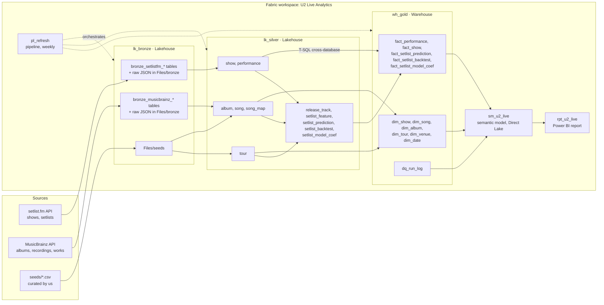
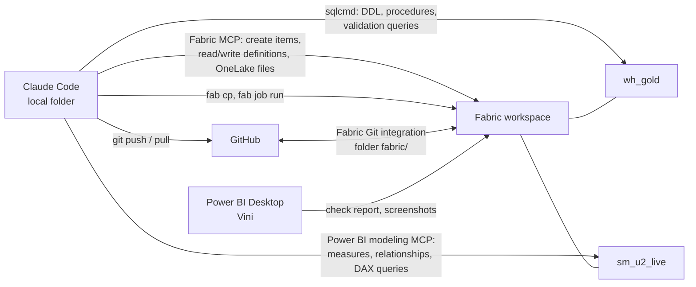

# Architecture

## Data flow

Bronze and Silver are PySpark (APIs, `u2lib`, fuzzy matching). Gold is T-SQL: stored procedures in `wh_gold` read
Silver through the `lk_silver` SQL analytics endpoint with three-part names (`lk_silver.dbo.show`) and rebuild the
star schema in one transaction.

## Why Gold is a Warehouse

| | Bronze and Silver: Lakehouse | Gold: Warehouse |
| --- | --- | --- |
| Work | Call REST APIs, keep raw files, Python logic (`u2lib`, `rapidfuzz`) | Joins and aggregations into a star schema: plain SQL |
| Language | PySpark notebooks | T-SQL stored procedures |
| Writes | `overwrite` per table | `DELETE` + `INSERT` of every Gold table in **one transaction**: the model never sees a half-built Gold, and a failed check rolls the whole refresh back |
| Typed contract | Delta schema from Spark | Explicit `CREATE TABLE` DDL in `sql/wh_gold/` (the contract with SPEC-05 is reviewable SQL) |

Trade-offs accepted: Gold logic cannot call `u2lib` (everything Python-specific, such as continents and song keys,
is finished in Silver); the `lk_silver` SQL endpoint must be synced before Gold runs (see SPEC-07); T-SQL in Fabric
Warehouse has no recursive CTEs and only a subset of types (`varchar` with UTF-8 collation, `bit`, `datetime2(6)`).

## Fabric items

| Item | Name | Notes |
| --- | --- | --- |
| Workspace | `U2 Live Analytics` | Not connected to git during development; `fabric/` and `sql/` are the local working copies. |
| Lakehouse | `lk_bronze` | Raw-ish tables per source (`bronze_<source>_<entity>`) + `Files/bronze/<source>/u2/<run_id>/` JSON + `Files/seeds/`. |
| Key Vault | `kv-vini-u2` | Secret `setlistfm-api-key`, read by notebooks with `notebookutils.credentials.getSecret`. Outside the workspace. |
| Lakehouse | `lk_silver` | Cleaned, typed, deduplicated, conformed names. One table per business entity. Gold reads it through its SQL analytics endpoint. |
| Warehouse | `wh_gold` | Star schema (schema `dbo`) + `dq_run_log`. Built by stored procedures. Only thing the semantic model reads. |
| Environment | `env_u2` | Spark environment with the `u2lib` wheel attached as a custom library. |
| Notebooks | `nb_u2_load_bronze` (setlist.fm, in production), `nb_bronze_musicbrainz`, `nb_bronze_seeds`, `nb_silver_shows`, `nb_silver_catalog`, `nb_silver_song_map`, `nb_silver_setlist_features`, `nb_silver_setlist_prediction` (SPEC-09) | PySpark. One notebook per step; parameters cell first. |
| Stored procedures | `wh_gold.dbo.usp_build_gold` (calls `usp_build_dimensions`, `usp_build_facts`, `usp_dq_gold`) | T-SQL. Source in `sql/wh_gold/`. |
| Pipeline | `pl_refresh` | Bronze notebooks → Silver notebooks (shows ‖ catalog → song map → setlist features → setlist prediction) → Stored procedure activity `usp_build_gold` → semantic model refresh. Weekly schedule. |
| Semantic model | `sm_u2_live` | Direct Lake on `wh_gold` tables (no views: views fall back to DirectQuery). Authored as TMDL (PBIP). |
| Report | `rpt_u2_live` | PBIR (PBIP). Reads only `sm_u2_live`. |

Both lakehouses have "Lakehouse schemas" on, so every table is in schema `dbo`. Notebooks read tables from other
lakehouses in the same workspace with three-part names (`lk_bronze.dbo.bronze_setlistfm_show`) and write to the notebook's default lakehouse. Notebooks append data quality results
to `wh_gold.dbo.dq_run_log` with the Fabric Spark connector for Warehouse (`u2lib.quality.Results.write`).

## Development loop (Claude Code + Fabric)

The workspace is the running copy and GitHub is the version-controlled copy. Fabric Git integration keeps `fabric/`
(notebooks, pipeline, environment, lakehouses, warehouse SQL project, model, report) in sync with branch `main`;
`sql/wh_gold/` stays the editable source for Warehouse DDL and procedures.

| Work | How it reaches the workspace |
| --- | --- |
| Notebooks and pipeline | Edited under `fabric/<item>/`, committed and pushed with Git, applied with *Source control → Update all*. Portal edits go the other way: *Commit* in Fabric, then `git pull`. |
| Running notebooks and the pipeline | `fab job run` (no MCP tool runs jobs); Vini can also run them in the browser. |
| Lakehouse files (seeds) | Fabric local MCP OneLake tools or `fab cp`. |
| Pure logic | `src/u2lib/`, unit-tested locally with `pytest`, built into a wheel attached to `env_u2`. Notebooks call it. |
| Warehouse tables and procedures | T-SQL files in `sql/wh_gold/` (idempotent: `CREATE OR ALTER PROCEDURE`, `IF OBJECT_ID(...) IS NULL CREATE TABLE`), applied with `sqlcmd` in the order of `sql/wh_gold/deploy.txt`. If Vini edits in the portal, script the object back into `sql/` first. |
| Running the Gold build | `sqlcmd -Q "EXEC dbo.usp_build_gold @run_id = '...'"` during development; the pipeline in production. |
| Semantic model | Power BI modeling MCP connected to `sm_u2_live` in the workspace; the change is committed from *Source control*, then `git pull` refreshes the TMDL copy in `fabric/sm_u2_live.SemanticModel/`. |
| Report | PBIR files in `fabric/rpt_u2_live.Report/` generated by `scripts/gen_report.py`, committed with Git and applied with *Update all*; no MCP edits reports. Vini opens it in Power BI Desktop (connected to the published model) to check rendering and take screenshots. |
| Validation queries | T-SQL on `wh_gold` (and `lk_silver` through cross-database queries) with `sqlcmd`; DAX through the Power BI modeling MCP; Spark SQL inside notebooks for Bronze. |

Setup and sign-in: `docs/setup.md`.

## Layer contracts (summary; details in the specs)

| Layer | Grain and rules |
| --- | --- |
| Bronze | One table per API entity (`bronze_<source>_<entity>`), values as delivered except lossless typing (dates, timestamps, coordinates), plus `_run_id`, `_ingested_at`. Full snapshot overwrite. Raw JSON kept in `Files/bronze/`. |
| Silver | Typed, trimmed, deduplicated; cancelled shows removed; snippet and tape flags derived; continents and song keys computed; every performance resolved to a `song_id` through `song_map` or explicitly marked unmapped. |
| Gold | Star schema with integer surrogate keys, no nulls in foreign keys (use `-1` "Unknown" members), English business names. Rebuilt atomically by `usp_build_gold`. |

## Naming

- Tables: `snake_case`, singular for entities (`show`, `song`), `fact_` / `dim_` prefixes in Gold.
- Columns: `snake_case`; booleans start with `is_` / `has_`; dates end with `_date`; surrogate keys end with `_key`; natural ids end with `_id`.
- Stored procedures: `dbo.usp_<verb>_<subject>`.
- Measures (semantic model): Title Case with spaces (`Shows`, `Songs Played`, `Avg Songs per Show`), grouped in display folders.
- Audit columns: `_run_id`, `_ingested_at` (Bronze), `_built_at` (Silver/Gold).

## Phases

1. **Foundation**: workspace, lakehouses, warehouse, MCP servers and CLI, environment, project conventions.
2. **Ingestion**: setlist.fm (exists), MusicBrainz, seeds.
3. **Silver**: shows, catalog, song mapping.
4. **Gold**: star schema in `wh_gold` (T-SQL).
5. **Semantic model**: Direct Lake model + measures.
6. **Report**: design system, wireframes, pages.
7. **Portfolio**: README and screenshots.
8. *(Optional)* Popularity enrichment (Last.fm listeners/playcount) → `fact_popularity`.
